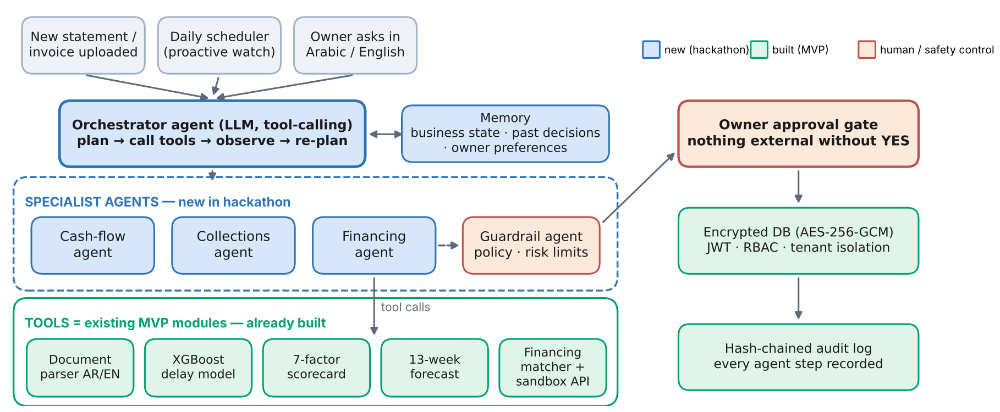

# MicroFlow Agent — Autonomous Cash-Flow & Financing Agent for SMEs

**Team FlowOps · ElSewedy University of Technology (SUTech) · AI Hackathon 2026 (AOU AI Summit) · Track 2: Agentic AI & Autonomous Intelligent Systems**

MicroFlow Agent helps small-business owners see a cash crisis weeks before it happens and act on it. It reads the documents an Egyptian SME already has (bank statements, e-invoices, even informal Arabic/English receipt notes), predicts when each customer will actually pay, forecasts cash 13 weeks ahead, explains a credit score factor by factor, finds the cheapest financing that closes the gap and drafts the application. Nothing is submitted without the owner's approval.

## Project status — what is built and what is next

> **Honest scope.** The current release (**v0.1 MVP**, October 2026, first built for the 2026 Shenzhen International FinTech Competition) runs a **fixed, rule-based agent workflow** and keyword-based Q&A. The **LLM-driven multi-agent layer is the hackathon build** and lives on the `hackathon` branch. All data and lenders are synthetic; no real money moves.

| | Capability | Where it lives |
|---|---|---|
| ✅ Built | Document ingestion (CSV/PDF statements; XML/JSON/PDF invoices; Arabic text), XXE-safe, 5 MB cap | `backend/parser.py` |
| ✅ Built | Field-level AES-256-GCM encryption, JWT, RBAC, tenant isolation, hash-chained audit log | `backend/security.py`, `backend/main.py` |
| ✅ Built | XGBoost payment-delay model (test MAE 6.46 days vs 7.70 baseline) | `backend/ai_engine.py` |
| ✅ Built | Explainable 7-factor credit scorecard + policy checks | `backend/ai_engine.py` |
| ✅ Built | 13-week cash forecast (base + stress) with alerts; financing matcher (cost per EGP 1,000) | `backend/copilot.py` |
| ✅ Built | Fixed workflow: observe → analyse → decide → draft → owner approval → sandbox lender | `backend/copilot.py` → `agent_plan`, `POST /api/agent/run` |
| 🔨 Hackathon | LLM orchestrator with tool calling (plan → act → observe → re-plan); existing modules exposed as typed tools | `hackathon` branch |
| 🔨 Hackathon | Specialist agents: cash-flow, collections (Arabic payment reminders), financing, guardrail | `hackathon` branch |
| 🔨 Hackathon | Memory of past decisions and owner preferences; proactive daily monitoring | `hackathon` branch |
| 🔨 Hackathon | LLM-based Arabic / Egyptian-dialect conversation replacing keyword Q&A | `hackathon` branch |

**Guardrails that will not change:** the LLM plans, but every number comes from the deterministic, tested tools; any action that leaves the system (a reminder, a financing application) needs the owner's explicit approval; every agent step is written to the tamper-evident audit log.

**Demo:** https://microflow-agent.streamlit.app/ · **Video:** https://youtu.be/OxxvpkEObDQ

## Quick start (local, ~3 minutes)

Requires Python 3.11+.

```bash
pip install -r requirements.txt
python scripts/generate_samples.py              # synthetic demo dataset
uvicorn backend.main:app --port 8000            # terminal 1: API  (docs at http://localhost:8000/docs)
streamlit run frontend/app.py --server.port 8501   # terminal 2: dashboard at http://localhost:8501
```

Or run `./run_local.sh` to do all of the above.

**Demo walkthrough (dashboard):**
1. Sign in as **SME owner – Al-Nour Bakery Supplies** (password `Demo@2026!`).
2. Tab 1: click **Load bundled demo dataset** (2 statements as CSV + PDF, invoices as XML, JSON and PDF).
3. Tab 2: **Generate credit dossier** — score, grade, factor contributions, policy checks.
4. Tab 3: cash-flow runway chart with base/stress scenarios and alerts.
5. Tab 4: **Run the copilot agent** (today: the fixed v0.1 workflow) → reasoning trace → financing draft → **Approve & submit** → sandbox provider response. Ask questions in English or Arabic.
6. Tab 5: audit log, **Verify hash chain integrity**, and the raw ciphertext the database stores.
7. Sign out and sign in as **Advisor**, **Bank auditor** or the **other tenant** to see role and tenant restrictions.

### Docker (Postgres + Redis + API + dashboard)

```bash
cp .env.example .env   # fill in MICROFLOW_MASTER_KEY, MICROFLOW_JWT_SECRET, POSTGRES_PASSWORD
docker compose up --build
```

Cloud Run: `gcloud run deploy microflow-api --source . --set-env-vars DATABASE_URL=...,MICROFLOW_MASTER_KEY=...` (store secrets in Secret Manager in production).

### Tests and execution evidence

```bash
python -m pytest -q                    # 22 tests: parsers, model, encryption, audit chain, RBAC, tenant isolation, full flow
python scripts/run_sandbox_demo.py     # regenerates evidence/ (sandbox operation logs)
```

---

## Architecture

### Current MVP (v0.1, built)


### Target agentic architecture (hackathon build)


*Green = existing MVP modules reused as agent tools · Blue = new agentic layer · Red = human and safety controls.*

<details>
<summary>Text version of the v0.1 pipeline</summary>

```
 Statements (PDF/CSV/text)   E-invoices (XML/JSON/PDF)
              │                        │
              ▼                        ▼
   ┌──────────────────────────────────────────────┐
   │ Ingestion (parser.py)                        │  magic-byte type check, 5 MB cap,
   │  XXE-safe XML · PDF text · CSV · Arabic text │  DTD/entity rejection, field validation
   └──────────────────────────────────────────────┘
              │ AES-256-GCM envelope encryption per field (security.py)
              ▼
   ┌──────────────────────────────────────────────┐
   │ PostgreSQL / SQLite (database.py)            │  amounts, names, tax ids stored as ciphertext
   └──────────────────────────────────────────────┘
              │ decrypt in memory, scoped to one tenant
              ▼
   ┌──────────────────────────────────────────────┐
   │ AI engine (ai_engine.py)                     │
   │  XGBoost delay model → expected pay dates    │
   │  7-factor explainable credit scorecard       │
   │  policy checks (history, affordability, HITL)│
   └──────────────────────────────────────────────┘
              ▼
   ┌──────────────────────────────────────────────┐
   │ Copilot (copilot.py)                         │
   │  13-week forecast (base/stress) + alerts     │
   │  financing matcher (cost-ranked)             │
   │  agent plan · NL Q&A (EN/AR)                 │
   └──────────────────────────────────────────────┘
              ▼
   FastAPI (main.py): JWT auth · RBAC · tenant scoping · hash-chained audit log
              ▼
   Streamlit dashboard (frontend/app.py)  ·  sandbox NBFI provider (simulated)
```
</details>

## Key results on the demo dataset

| Metric | Value |
|---|---|
| Delay model (XGBoost) test MAE | 6.46 days vs 7.70 for the buyer-average baseline (16% better) |
| Credit score | 57.9 / 100 (grade C) — flagged for advisor review (< 60) |
| Cash alert | Balance turns negative in week 1 (payroll lands before collections) |
| Funding gap to 7-day buffer | EGP ~392k |
| Agent recommendation | Factor 4 invoices with NileFactor: EGP 414,630 unlocked for EGP 17,332 (vs EGP 37,355 for a 6-month loan) |
| Security tests | 12 / 12 passed (`evidence/security_tests.json`) |

## Data and honesty notes

- **All data is synthetic.** Businesses, buyers and providers (NileFactor, Delta Receivables Finance, Cairo Micro Lending) are fictional; the provider is a deterministic sandbox and no real money moves.
- The delay model is trained on a simulation of B2B payment behaviour (`ai_engine.generate_training_data`). With real ledgers it retrains on the same feature columns.
- Policy parameters in `backend/config.py` (`POLICY`) are illustrative and editable. The simplified-tax-regime flag is an indicator, not tax advice.
- Demo users and password are seeded for judging only (`MICROFLOW_SEED_DEMO=0` disables them).

## API reference (main endpoints)

| Method | Path | Permission |
|---|---|---|
| POST | `/api/auth/login` | public |
| POST | `/api/upload-statement`, `/api/upload-invoice` | `data:upload` (owner) |
| POST | `/api/demo/load-samples` | `data:upload` |
| GET | `/api/invoices` | `data:read` |
| POST | `/api/score-credit` · GET `/api/credit-dossier` | `credit:score` · `credit:read` |
| POST | `/api/forecast-cashflow` | `forecast:run` |
| GET | `/api/financing/offers`, `/api/financing/applications` | `financing:read` |
| POST | `/api/agent/run`, `/api/agent/ask` | `agent:run`, `agent:ask` |
| POST | `/api/financing/applications/{id}/approve` · `/reject` | `financing:approve` (owner only) |
| GET | `/api/audit-logs` · `/api/audit-logs/verify` | own scope · `audit:verify` (auditor) |

Interactive docs: `http://localhost:8000/docs`.

## Repository layout

```
backend/   config, database, security, parser, ai_engine, copilot, cache, main (API)
frontend/  app.py (Streamlit dashboard)
scripts/   generate_samples.py, run_sandbox_demo.py
tests/     pytest suite
data/samples/   synthetic statements and invoices
evidence/  sandbox operation logs (MVP v0.1)
docs/      technical documentation, security self-assessment
```

## Team

**Team FlowOps** — ElSewedy University of Technology (SUTech), Faculty of Computer Engineering Technology, Cairo, Egypt

- Kareem Diaa Helal — Team Leader
- Ahmed Mohamed Elsayed Mohamed
- Mostafa Abdelhamed Mahmoud

**Academic supervisor:** Prof. Dr. Rehab Farouk Abdelkader

## Project history

- **v0.1 (Oct 2026):** MVP built for the 2026 Shenzhen International FinTech Competition (International Track, Topic E: SME Finance Copilot) under the name *MicroFlow AI*. Its documents are kept in `docs/` as a record.
- **v0.2 (Dec 2026, in progress):** MicroFlow Agent, the agentic multi-agent version, for AI Hackathon 2026.

## License

MIT for the team's code. Third-party libraries keep their own licenses (FastAPI MIT, XGBoost Apache-2.0, PyMuPDF AGPL-3.0, Streamlit Apache-2.0, cryptography Apache-2.0/BSD).
