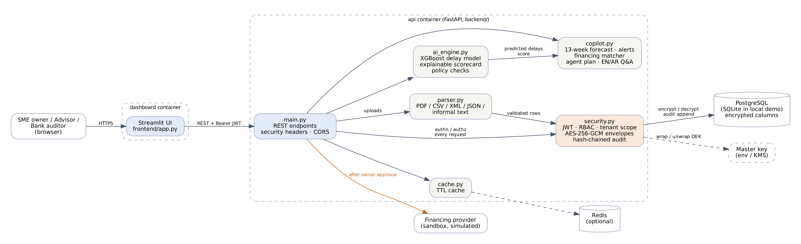
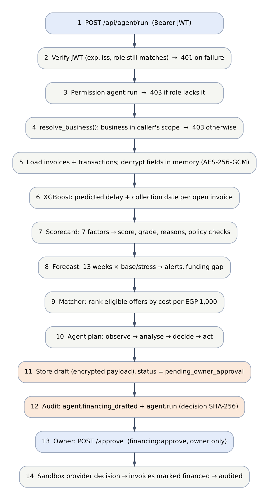

# 1. Summary

MicroFlow AI is an AI agent that acts as a finance copilot for small-business owners. From documents an SME already has (bank statements, e-invoices, informal receipts) it:

1. predicts when each open invoice will actually be paid (XGBoost regression);
2. forecasts cash 13 weeks ahead under base and stress scenarios and raises alerts;
3. produces an explainable alternative credit score from cash-flow behaviour rather than audited accounts;
4. compares financing options and picks the cheapest one that closes the cash gap;
5. drafts the financing application, routes it to the owner for approval, then submits it to a (sandbox) provider.

Every AI output and every user action is written to a tamper-evident, hash-chained audit log. Sensitive fields are encrypted at rest with AES-256-GCM envelope encryption. Three permission tiers (SME owner, advisor, bank auditor) and per-tenant scoping are enforced on every endpoint.

**Problem context (verified figures, see References).**

- Egyptian firms fund almost all investment themselves: about 88% of capital expenditure is financed internally and only 3% by banks, against 15% bank financing across the MENA region (World Bank Enterprise Survey fieldwork Sept 2025 – Jan 2026, as reported by EnterpriseAM) [1].
- Only 4.8% of Egyptian firms use banks to finance working capital (World Bank Enterprise Survey, 2020) [2].
- IFC puts the lending gap for Egypt's MSMEs at about USD 71 billion (IFC press release, December 2023) [3]; MSMEs contribute more than a third of GDP and employ almost 40% of the workforce (IFC, November 2025) [4].
- The policy push already exists: in 2021 the Central Bank of Egypt required banks to raise MSMEs' share of their loan portfolios by five percentage points to 25% [5]. Banks still need a way to assess firms without audited statements.
- Credit is expensive: the CBE overnight lending rate is 20.00% (cut to this level on 12 February 2026 and held on 24 September 2026) [6][7], so the cheapest suitable product matters.
- Law No. 6 of 2025 created a simplified tax regime for businesses with annual turnover up to EGP 20 million, effective 1 March 2025 [8]; MicroFlow shows an eligibility indicator, not tax advice.

MicroFlow targets this gap: it turns the transaction trail a business already produces into a forward view of cash and a fundable, explainable credit profile.

# 2. System architecture

| Layer | Component | Technology |
|---|---|---|
| Presentation | Dashboard with 5 tabs (ingestion, dossier, runway, agent, audit vault) | Streamlit + Altair |
| API | REST API, JWT auth, RBAC, tenant scoping, security headers | FastAPI, Pydantic, PyJWT |
| Ingestion | Statement and invoice parsers with validation | PyMuPDF, csv, ElementTree (DTD-free), regex |
| AI | Invoice-delay model; explainable credit scorecard; policy checks | XGBoost, pandas, NumPy |
| Copilot | 13-week forecast, alerts, financing matcher, agent planner, EN/AR Q&A | Python |
| Security | Envelope encryption, password hashing, audit hash chain | `cryptography` (AES-GCM), PBKDF2-SHA256, SHA-256 |
| Data | Relational store; optional shared cache | PostgreSQL/Supabase (SQLite for local demo); Redis (in-memory fallback) |
| Deployment | Container, compose stack, Cloud Run-ready | Docker, docker-compose |

**Deployment units and interactions.** The backend is a modular service: parser, AI engine, copilot, security and cache are separate Python modules with narrow interfaces inside one FastAPI process, which keeps the prototype simple to run. In deployment the stack runs as four containers (API, dashboard, PostgreSQL, Redis, see `docker-compose.yml`); the AI engine and copilot can be split into their own services later without changing their interfaces.

{width=100%}

**Data flow: one agent run, end to end.** Every step that touches data goes through the security layer, and the two writes at the end are both encrypted and audited.

{width=62%}

| Data | Enters as | Stored as | Leaves as |
|---|---|---|---|
| Statement rows | PDF / CSV / text upload | `transactions` (description, amount, balance encrypted; date, category plain) | decrypted in memory for scoring and forecasting only |
| Invoices | XML / JSON / PDF upload | `invoices` (buyer name, tax id, amount encrypted; buyer grouped by HMAC `buyer_ref`) | API response to owner/advisor; banded amounts to auditors |
| Credit dossier | computed | `credit_scores.dossier_enc` + SHA-256 in audit log | dossier endpoint (masked for auditors) |
| Financing application | drafted by agent | `financing_applications.payload_enc`, status workflow | sandbox provider, only after owner approval |
| Audit events | every action | `audit_logs` (append-only, hash-chained) | audit endpoints by role; verification endpoint |

**Data model.** `businesses`, `users`, `invoices`, `transactions`, `credit_scores`, `financing_applications`, `audit_logs`. Columns ending in `_enc` hold ciphertext envelopes. Buyers are grouped by `buyer_ref`, an HMAC-SHA256 of the buyer tax id, so analytics never need the plaintext id.

# 3. Core algorithms

## 3.1 Document ingestion

- **File typing** by magic bytes before extension (`%PDF-`, `<`, `{`/`[`), 5 MB cap, 50-page cap for PDFs.
- **E-invoices:** XML batch or single invoice, JSON, or PDF (field regexes). Validation: required fields present, amount > 0, due date ≥ issue date. Duplicate invoice numbers per business are skipped.
- **Bank statements:** PDF rows (`date | description | debit | credit | balance`) or CSV export. Each transaction is categorised (instant-payment inflow, customer payment, supplier, payroll, rent, utility, loan, tax, other) by keyword rules.
- **Informal records:** a fallback parser for typed or chat-exported notes in English or Arabic (e.g. an Arabic note recording EGP 8,200 received from a café), extracting date, amount and direction. This covers businesses without clean digital ledgers.
- A SHA-256 of every source file is stored with its rows and recorded in the audit log, so any figure can be traced back to the exact document it came from.

## 3.2 Invoice payment-delay model (XGBoost)

Target: days paid after the due date. Features per invoice:

| Feature | Meaning |
|---|---|
| `buyer_hist_avg_delay` | buyer's average past delay with this business (sector prior if no history) |
| `buyer_hist_late_ratio` | share of the buyer's past invoices paid > 5 days late |
| `buyer_hist_count` | number of past invoices |
| `log_amount`, `amount_vs_buyer_avg` | invoice size, absolute and relative to the buyer's usual order |
| `terms_days` | agreed payment terms |
| `sector_code` | hotel, supermarket, government, café, distributor, general |
| `issue_month` | seasonality (year-end slowdown) |

Training data is a generative simulation of B2B payment behaviour (400 buyers, latent reliability, sector effects, order-size effects, terms and year-end seasonality; seed fixed). Model: `XGBRegressor(n_estimators=350, max_depth=4, learning_rate=0.05)`; 80/20 split.

**Result:** test MAE **6.46 days** vs **7.70 days** for the naive "buyer's historical average" baseline (16% improvement). Top features: buyer history (0.51), sector (0.31), relative order size (0.05). With real ledgers the model retrains on the same columns.

Each open invoice receives a predicted delay, an expected collection date (`due + delay`) and a collection probability (0.97 if ≤ 30 days late, 0.92 if ≤ 60, 0.82 beyond).

## 3.3 Explainable alternative credit scorecard

A transparent weighted scorecard was chosen over a black-box classifier so that every score can be explained to the owner, an advisor or a bank auditor. Each factor is mapped linearly to 0–100 between a "worst" and "best" anchor, multiplied by its weight, and summed.

| Factor (weight) | Measure | 0 → 100 anchors |
|---|---|---|
| Inflow stability (0.18) | coefficient of variation of monthly inflows | 0.8 → 0.1 |
| Net cash margin (0.17) | (inflows − outflows) / inflows | −15% → +20% |
| Obligation consistency (0.15) | months with utilities/rent/payroll/loan paid, and day-of-month regularity | coverage 30% → 100%; spread 10 → 1.5 days |
| Digital footprint (0.10) | share of inflows via instant payments | 0% → 50% |
| Receivables quality (0.18) | blended DSO (50% historical, 50% model-predicted on open book) | 120 → 30 days |
| Buyer concentration (0.10) | Herfindahl index of invoiced sales by buyer | 0.6 → 0.1 |
| Liquidity buffer (0.12) | days of outflows covered by current balance | 0 → 45 days |

Grades: A ≥ 80, B ≥ 65, C ≥ 50, D ≥ 35, else E. The dossier lists each factor's raw value, sub-score, weight, contribution and a plain-language reason, plus the two strongest and two weakest factors. The receivables factor is where the machine-learning model feeds the score.

**Policy checks** (parameters in `config.POLICY`, illustrative and editable): minimum 3 months of data; explainability present; human-in-the-loop (scores < 60 require advisor review, and no application is ever sent without owner approval); affordability cap (repayments ≤ 35% of average monthly inflow); and an indicator of whether annualised turnover is under the EGP 20M simplified-tax-regime threshold (indicator only).

## 3.4 Cash-flow forecast and alerts

Horizon 13 weekly buckets from the statement date. Components:

- **Open invoices:** collected in the week of their predicted collection date × collection probability. Invoices whose predicted date has already passed are moved to the earliest plausible week.
- **Fixed obligations:** payroll, rent, utilities, loan instalments and tax repeat monthly on their usual day, at the median monthly amount.
- **Variable outflows and instant-payment inflows:** historical weekly averages.
- **Future sales:** collections from not-yet-issued invoices start only after the historical DSO.
- **Stress scenario:** +21 days delay on every invoice, 85% collection, 90% sales.

Alerts: insolvency (balance < 0; critical in base, warning in stress), low cash buffer (below 7 days of outflows), buyer concentration (> 35% of open receivables), and overdue invoices with their predicted arrival. Funding gap = buffer target − lowest base-case balance.

## 3.5 Financing matcher

Three sandbox products with eligibility rules: invoice factoring (score ≥ 45, 85% advance, 2.2% per 30 days), invoice discounting (score ≥ 60, 90% advance, 1.8% per 30 days, shorter predicted delays only) and a 6-month working-capital loan (score ≥ 50, 32% p.a. — an illustrative SME rate above the 20% CBE overnight lending rate [7], capped by score and by the affordability rule). For receivables products, eligible invoices are ranked by effective APR (fee ÷ advance × 365 ÷ days to collection) and added greedily until the gap is covered. Options are ranked first by whether they cover the gap, then by cost per EGP 1,000 raised.

On the demo dataset the agent recommends factoring four invoices: **EGP 414,630 unlocked for EGP 17,332**, versus EGP 37,355 for the loan. Discounting is shown as ineligible (score 57.9 < 60), with the reason.

## 3.6 Agent loop and guardrails

`observe` (balance, alerts) → `analyse` (score, gap, base and stress minimums) → `decide` (no action / escalate / cheapest covering option) → `act` (draft application, request advisor review if score < 60, publish alerts) → `guardrail` (drafts wait for owner approval). Re-running the agent reuses an identical pending draft instead of creating duplicates. After approval, the sandbox provider returns a deterministic decision and reference (e.g. `SBX-F4025422B7`), financed invoices are marked so they cannot be pledged twice, and both steps are audited.

## 3.7 Natural-language Q&A

Intent routing (English and Arabic keywords) over the business's own computed results: cash runway, score explanation, likely late payers, best financing, tax-threshold indicator. Answers are generated from structured results only, so the copilot cannot state figures that are not in the data.

# 4. Security design (summary)

Full detail, permission matrix and known-risk list: *Security Self-Assessment Report*.

- **Encryption at rest:** AES-256-GCM envelope encryption per field; a fresh 256-bit data key per value, wrapped by a master key held outside the database (KMS-ready); column context bound as AAD so ciphertext cannot be moved between columns.
- **Authentication:** PBKDF2-HMAC-SHA256 (600,000 iterations, per OWASP guidance, per-user salt); JWT HS256 with 60-minute expiry, issuer check and role re-validation on every request; lockout after 5 failed logins.
- **Authorisation:** permission-based RBAC (owner, advisor, auditor) plus tenant scoping on every business-bound endpoint; auditors see banded amounts only.
- **Integrity:** append-only audit log with SHA-256 hash chaining; ORM blocks updates and deletes; a verification endpoint recomputes the chain and reports the first broken entry.
- **Input security:** DTD/entity declarations rejected (XXE and entity expansion), magic-byte typing, size and page caps, schema validation.

# 5. Testing and execution evidence

- `pytest`: 22 tests covering parsers (all formats, Arabic text, XXE), model quality vs baseline, encryption round-trip and tamper detection, password hashing, audit-chain tamper detection, full owner flow, RBAC denials, tenant isolation, malicious upload, login lockout. All pass.
- `scripts/run_sandbox_demo.py` replays the full scenario through the API on a fresh database and writes `evidence/execution_log.jsonl` (every request and response), `security_tests.json` (12/12 passed), `audit_chain.json` (full chain + verification) and `summary.json`.

# 6. Limitations and next steps

- Training data is synthetic; next step is calibration on anonymised real ledgers from pilot SMEs.
- Financing providers are simulated; integration would use each provider's API under a data-sharing agreement.
- Statement parsing targets a defined layout; bank-specific templates (or a layout model) are needed for broad coverage.
- Scorecard weights are expert-set; with outcome data they can be fitted (e.g. logistic regression) while keeping the same explainable form.

# 7. References

1. EnterpriseAM, "Egyptian firms bypass banks to fund growth from their own pockets," 1 June 2026 (citing the World Bank Enterprise Survey). https://enterpriseam.com/egypt/2026/06/01/egyptian-firms-bypass-banks-to-fund-growth-from-their-own-pockets/
2. World Bank, Enterprise Surveys indicator IC.FRM.BKWC.ZS, "Firms using banks to finance working capital (% of firms)," Egypt, 2020. https://data.worldbank.org/indicator/IC.FRM.BKWC.ZS?locations=EG
3. IFC press release, Cairo, 4 December 2023 (partnership with Al Baraka Bank Egypt). https://pressroom.ifc.org/All/Pages/PressDetail.aspx?ID=27901
4. IFC press release, 4 November 2025, "IFC partners with Suez Canal Bank to strengthen Egypt's financial sector for SME growth." https://www.ifc.org/en/pressroom/2025/ifc-partners-with-suez-canal-bank-to-strengthen-egypt-s-financial-sector-for-sme-g
5. EnterpriseAM, "MSMEs will have an easier time getting bank finance thanks to the CBE," 23 February 2021. https://enterpriseam.com/egypt/2021/02/23/msmes-will-have-an-easier-time-getting-bank-finance-thanks-to-the-cbe/
6. Amwal Al Ghad, "Egypt's central bank cuts key interest rates by 100bps in first 2026 MPC meeting," 12 February 2026. https://en.amwalalghad.com/?p=225234
7. Sharjah24, "Central Bank of Egypt maintains key interest rates unchanged," 24 September 2026. https://sharjah24.ae/en/Articles/2026/09/24/Central-Bank-of-Egypt-maintains-key-interest-rates-unchanged
8. EY Tax Alert, "Egypt introduces tax incentives and benefits for small enterprises," 28 February 2025. https://www.ey.com/en_gl/technical/tax-alerts/egypt-introduces-tax-incentives-and-benefits-for-small-enterprises
9. OWASP Password Storage Cheat Sheet (PBKDF2-HMAC-SHA256: 600,000 iterations). https://cheatsheetseries.owasp.org/cheatsheets/Password_Storage_Cheat_Sheet.html
10. Competition rules: PBCSF Appendix 2, Problem Description and Competition Rules for International Track. https://www.its.ac.id/international/wp-content/uploads/sites/66/2026/10/PBCSF-Appendix-2-Problem-Description-and-Competition-Rules-for-International-Track.pdf
